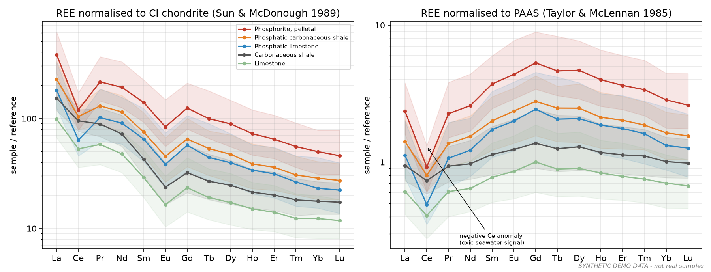
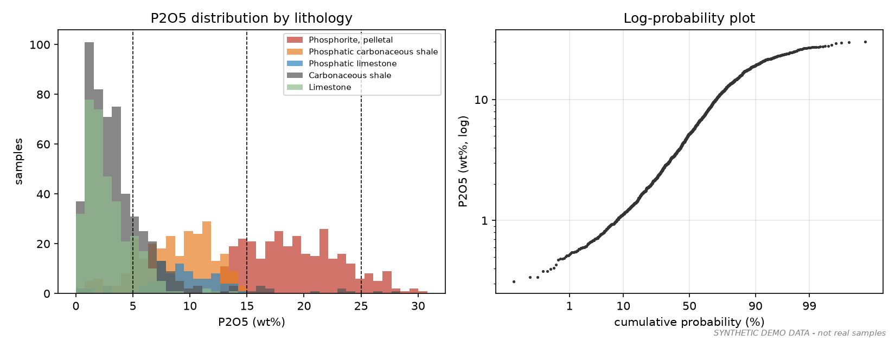
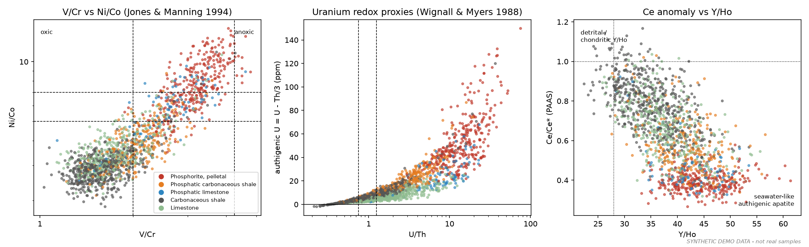
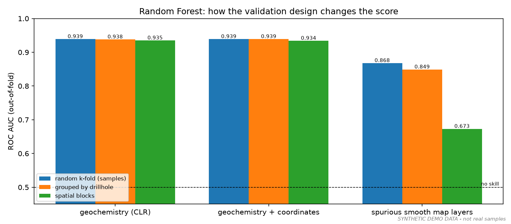
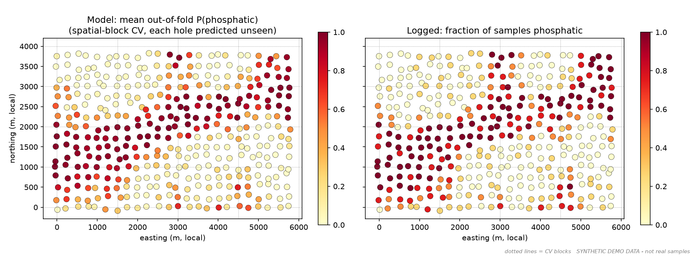

# Geology — exploration geochemistry and phosphate prospectivity in Python

**Yashu Joshi** · Exploration Geologist · M.Tech Geoexploration (IIT Bombay)

I have spent ten years as an exploration geologist with Mineral Exploration and
Consultancy Ltd (MECL), a Government of India enterprise, working on phosphate, gold,
base-metal, lithium and REE projects from reconnaissance (UNFC G4) through general
exploration (G3): drilling supervision, core logging, QA/QC and geochemical
interpretation.

This repository holds small, reproducible Python workflows of the kind I use on
exploration data: geochemical plotting, REE normalisation, palaeoredox screening,
and a machine-learning prospectivity demo for sedimentary phosphate.

> **All data in this repository are synthetic.** They are generated by code in
> `phosprospect/synthetic.py` from textbook end-member compositions. No MECL,
> Government of India or client data are included, and none of the numbers below
> describe a real deposit.

---

## Contents

| Path | What it does |
|---|---|
| `scripts/01_geochemistry_plots.py` | P2O5 statistics by lithology, log-probability plot, chondrite- and PAAS-normalised REE spider plots, palaeoredox cross-plots |
| `scripts/02_phosphate_prospectivity_ml.py` | Features → CLR transform → Random Forest / XGBoost → spatial block cross-validation → maps and interpretation |
| `phosprospect/` | Small package: geochemical feature engineering (`features.py`), reference compositions (`reference.py`), two-stage target definition (`targets.py`), synthetic data generator (`synthetic.py`) |
| `figures/` | Outputs of the two scripts (PNG figures and CSV tables) |
| `data/synthetic_demo_assays.csv` | The synthetic assay table both scripts use (1,536 samples from 384 holes) |

## How to run

Python 3.10 or later.

```bash
pip install -r requirements.txt
python scripts/01_geochemistry_plots.py
python scripts/02_phosphate_prospectivity_ml.py
```

The first script takes a few seconds; the second about a minute and a half.
XGBoost is optional; without it the ML script runs with Random Forest only.

To try the plots on your own data, replace `load_assays()` in script 01 with a CSV
reader. Majors go in wt% (`P2O5`, `CaO`, `SiO2`, `Al2O3`, …) and traces and REE in
ppm, with a `lithology` column.

---

## 1. Geochemistry plots

**REE spider plots.** I normalise to CI chondrite (Sun & McDonough, 1989) and to PAAS
(Taylor & McLennan, 1985). For sedimentary rocks PAAS is the more useful baseline,
because it removes the ordinary detrital pattern. What remains is the authigenic
signal: a middle-REE bulge and a negative Ce anomaly, which marine apatite inherits
from oxic seawater.



**P2O5 statistics.** Summary statistics by logged lithology, plus a log-probability
plot, where breaks in slope point to mixed populations. Dashed lines mark 5, 15 and
25 % P2O5.



**Palaeoredox proxies.** V/Cr against Ni/Co, with fields after Jones & Manning (1994).
Authigenic U (U − Th/3) after Wignall & Myers (1988). Ce/Ce* against Y/Ho, where
seawater-derived apatite plots low on Ce/Ce* and above the chondritic Y/Ho of about 28.



## 2. Phosphate prospectivity with machine learning

**The question.** Can the pathfinder elements alone pick out samples a geologist
logged as phosphatic? Here the pathfinders are REE, Y, U, Sr, redox metals and
detrital elements. P2O5, CaO and F are deliberately withheld, which is the situation
with older multi-element datasets that never reported phosphorus. Withholding them
also stops the model from simply reading grade off the assay.

**Workflow**

1. **Target:** the logged lithology (stage 1: is a phosphatic system present?). It is
   kept independent of the geochemistry used as input.
2. **Features:** the composition, all analytes in ppm, through a centred log-ratio
   (CLR) transform. Geochemical data are compositional (they sum to 100 %), so raw
   concentrations carry spurious negative correlations. CLR removes that closure.
3. **Models:** Random Forest and XGBoost.
4. **Validation:** the same models are scored three ways: random k-fold over samples,
   folds grouped by drillhole, and folds grouped by 1.5 × 1 km spatial blocks.
5. **Interpretation:** permutation importance measured on held-out blocks, a
   prospectivity map built from out-of-fold predictions, and a list of samples where
   the model and the core log disagree.

### Why spatial block cross-validation?

Nearby samples resemble each other. With random k-fold, every test sample has
neighbours in the training set, so a model can score well just by remembering
*where* the good samples are, without learning anything about *why* they are good.
That score will not hold up in a new area.

The third group of bars below shows the trap. These "map layers" are smooth random
surfaces with no geological link to phosphate, standing in for gridded geophysics or
interpolated geochemistry. Random k-fold gives them a ROC AUC of 0.87. Spatial
blocks bring it down to 0.67, and that leftover 0.67 is only chance correlation
between a few smooth surfaces and the phosphate belt.

The sample-level geochemistry holds at about 0.94 under all three schemes. Its
signal sits in each sample's own chemistry, not in its location. So the honest
lesson is that how much spatial CV matters depends on the features. It matters most
for the gridded evidence layers used in regional prospectivity mapping, and that
is exactly where it gets skipped.





### Interpretation, including what not to read into it

- **Feature importance** (`figures/feature_importance.png`) ranks MgO first. That
  comes from the synthetic end-members, where the francolite is Mg-poor. It is not
  a geological finding. Importances describe the training data, and correlated CLR
  features share importance between them. That is why I report them as
  mean ± sd across spatial folds.
- **The rule-based indicator score** (`phosprospect.targets.authigenic_score`) flags
  many marine limestones as well as phosphorites. Y/Ho and Ce anomalies record
  seawater, not phosphate specifically, so the indicators need a grade or apatite
  check alongside them.
- **Model vs core log:** 90 samples where the out-of-fold prediction strongly
  disagrees with the log are written to `figures/samples_to_relog.csv`. Because the
  data are synthetic, the true composition is known: 81 of the 90 really were
  mis-logged. On real data this is the practical use: a short list of intervals to
  re-check in the core shed.

## Limitations

- Synthetic data with a simple three-end-member mixing model. Real phosphorites
  have diagenetic overprints, weathering and laboratory effects that are not
  modelled here.
- Sample-level classification, not a gridded regional prospectivity model.
- Thresholds in `phosprospect/targets.py` are literature-based judgements, not
  tuned values.

## References

- Bau, M. & Dulski, P. (1996). *Precambrian Research* 79, 37–55. Ce anomaly.
- Jones, B. & Manning, D.A.C. (1994). *Chemical Geology* 111, 111–129. Redox indices.
- Sun, S.-s. & McDonough, W.F. (1989). *Geol. Soc. Spec. Publ.* 42, 313–345. Chondrite.
- Taylor, S.R. & McLennan, S.M. (1985). *The Continental Crust: its Composition and Evolution.* PAAS.
- Wignall, P.B. & Myers, K.J. (1988). *Geology* 16, 452–455. Authigenic U.
- Aitchison, J. (1986). *The Statistical Analysis of Compositional Data.* CLR.
- Roberts, D.R. et al. (2017). *Ecography* 40, 913–929. Block cross-validation.

## How this was built

I wrote this code with an AI coding assistant. The geological framing is mine: the
choice of proxies, the two-stage target, withholding grade analytes, and using
spatial validation. I have checked the outputs against what I would expect from
phosphorite geochemistry.
